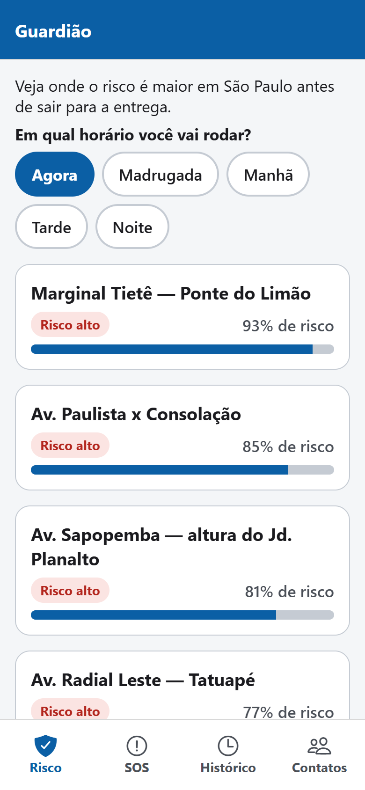
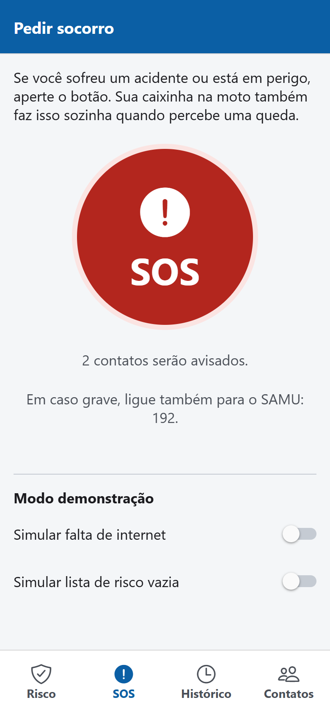
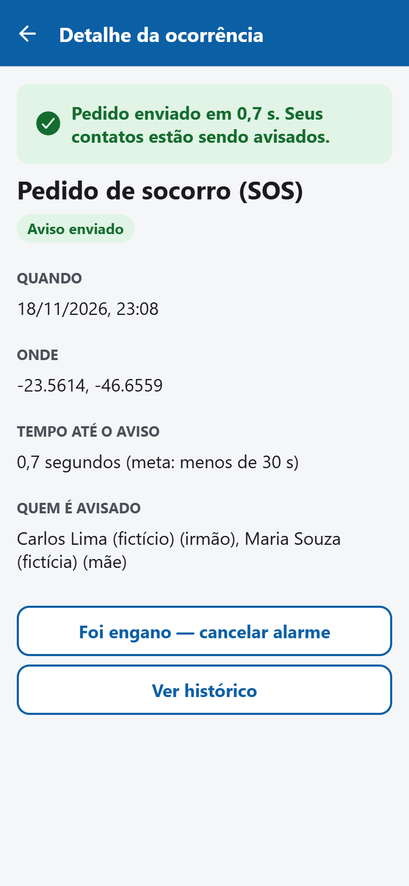
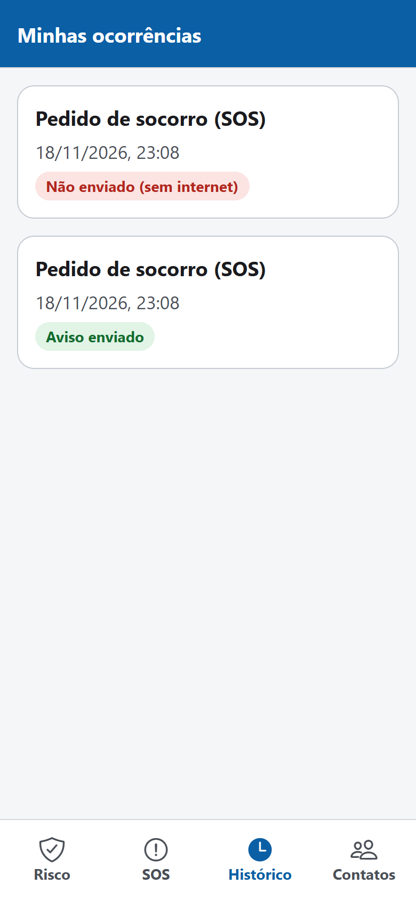
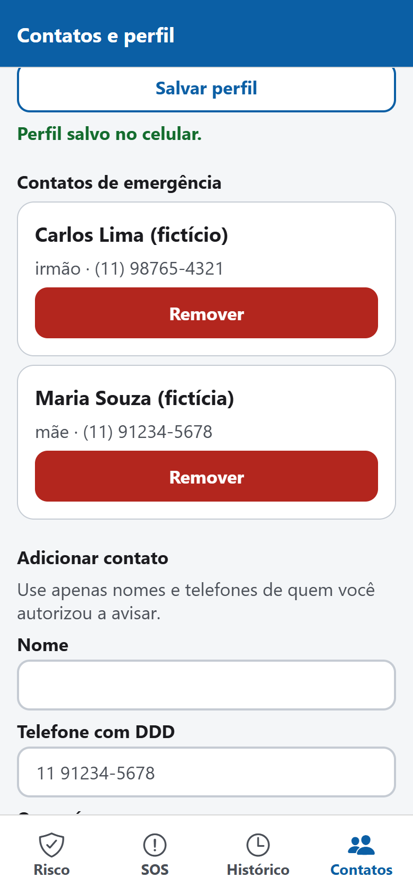
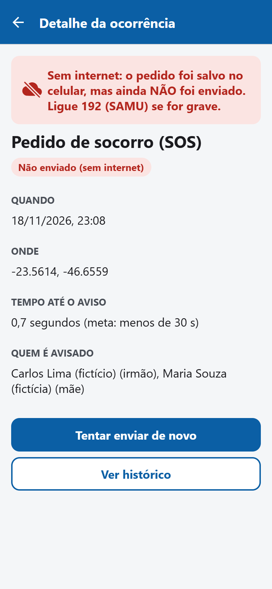
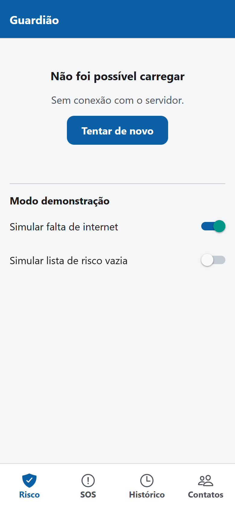

# Guardião — App mobile (Global Solution 2026.2 · CitizenTech)

App em **React Native + Expo** para o **motoboy de aplicativo**: mostra **onde o risco é maior em São Paulo naquele horário** e tem um **botão de SOS** que avisa os contatos de emergência com a localização.

Disciplina: **Mobile Development & IoT** · Este repositório contém o app mobile do projeto Guardião.

---

## 1. Ficha da CitizenTech

| Campo | Resposta |
|---|---|
| **Nome** | Guardião |
| **Cidade e bairro** | São Paulo |
| **Cidadão beneficiado** | Entregador de moto (motoboy) que trabalha por aplicativo |
| **Problema, em uma frase** | O entregador de moto em São Paulo não sabe onde o risco é maior e, quando cai, o socorro demora porque ninguém é avisado. |
| **Como funciona** | Uma caixinha na moto percebe a queda e pede socorro sozinha; o app avisa quais regiões são perigosas naquele horário. |
| **O que cada parte faz** | ESP32 detecta a queda · API guarda e notifica · ML calcula o risco por região e horário · **App mostra o risco e tem o SOS** · Linux hospeda a API · Segurança protege os dados do motoboy |
| **Link do repositório** | _preencher_ |
| **Indicador de impacto** | Tempo entre a queda e o aviso ao contato de emergência (meta: menos de 30 s) |
| **ODS conectados** | 3 (meta 3.6, mortes no trânsito), 9 e 11 |

---

## 2. Integrantes

| Nome | RM |
|---|---|
| Rodrigo Nakata | 556417 |
| Gabriel Padula | 554907 |
| Arthur Abonizio | 555506 |

---

## 3. Como rodar o app

Pré-requisitos: [Node.js](https://nodejs.org) **22.13 ou mais novo** (exigência do Expo SDK 58) e o app **Expo Go** no celular (ou um emulador).

```bash
npm install
cp .env.example .env # opcional
npx expo start
```

Leia o QR Code com o Expo Go (Android) ou com a câmera (iOS). No emulador, pressione `a` (Android) ou `i` (iOS).

### Configurando o `.env`

O app **funciona sem configuração** (usa dados simulados). O `.env` está no `.gitignore` e **não** vai para o GitHub.

| Variável | Para que serve |
|---|---|
| `EXPO_PUBLIC_API_URL` | URL base da API .NET do Guardião (ex.: `http://192.168.0.10:5000`). Com ela, o app chama `/api/zonas-risco`, `POST /api/ocorrencias` e `PATCH /api/ocorrencias/{id}/cancelar`. Vazia = modo simulado (mock). |

Não há chaves nem senhas de banco, pois o banco é local.

---

## 4. A jornada do motoboy no app

| Aba / tela | O que o motoboy faz | Dados |
|---|---|---|
| **Risco** | Escolhe o horário (agora, madrugada, manhã, tarde, noite) e vê as regiões ordenadas por risco (baixo, médio, alto) com a porcentagem. | API/mock `GET /api/zonas-risco` |
| **SOS** | Aperta o botão grande, confirma, e o pedido é registrado com a localização e enviado. Se não houver internet, fica **pendente** no celular. | `POST /api/ocorrencias` + SQLite |
| **Detalhe da ocorrência** | Vê o status, o tempo até o aviso, quem foi avisado. Pode **cancelar alarme falso** ou **tentar enviar de novo**. | `PATCH .../cancelar` + SQLite |
| **Histórico** | Consulta as quedas e SOS anteriores. | SQLite |
| **Contatos** | Cadastra o próprio nome, o código da caixinha (ESP32) e os contatos de emergência. | SQLite |

O app mostra o **indicador de impacto** da Ficha: o **tempo entre acionar o SOS e o aviso ser enviado** (meta: menos de 30 s).

---

## 5. Banco de dados escolhido: SQLite (`expo-sqlite`)

**Por quê?**

- **Funciona sem internet.** Quem cai de moto pode estar sem sinal: o SOS é salvo no celular na hora e reenviado depois (status `PENDENTE`). Isso não seria possível com um banco só em nuvem.
- **Privacidade (Segurança).** Contatos de emergência e localização ficam no aparelho do motoboy.
- **Gratuito**, sem conta, sem chaves e sem senhas no repositório.
- É um banco relacional com SQL e roda dentro do Expo Go.

**Tabelas** (`src/database/`):

| Tabela | Conteúdo |
|---|---|
| `ocorrencias` | Queda/SOS: dispositivo, tipo, latitude, longitude, intensidade G, data/hora, status (`ENVIADA`, `PENDENTE`, `CANCELADA`), tempo até o aviso |
| `contatos` | Contatos de emergência (nome, telefone, quem é) |
| `settings` | Nome do motoboy e código da caixinha |

O acesso ao banco fica numa **camada própria** (`db.ts` + um repositório por tabela); as telas nunca escrevem SQL.

---

## 6. De onde vêm os dados

- **Zonas de risco**: no modo simulado, vêm de `src/services/zonasRiscoService.ts`. Os **nomes dos cruzamentos são locais públicos de São Paulo** e os **scores são inventados** para a demonstração (mais alto na madrugada e no fim da tarde). O formato é o mesmo da resposta real da API, que traz o score do modelo de ML (treinado com dados públicos do Infosiga). Para usar a API real, basta definir `EXPO_PUBLIC_API_URL`; as telas não mudam.
- **Ocorrências e contatos**: criados no próprio app e salvos no SQLite.
- **Posição (GPS)**: lida do celular com `expo-location`, com permissão do usuário. Se negar, usa a Av. Paulista como posição aproximada.
- **Nenhum dado pessoal real**: nomes e telefones usados nos testes e no vídeo são fictícios.

Todas as telas que consomem dados tratam **carregando**, **erro** (com “Tentar de novo”) e **lista vazia**. O bloco **Modo demonstração** (fim das abas Risco e SOS) simula falta de internet e lista vazia, para mostrar esses estados no vídeo.

---

## 7. Estrutura do projeto

```
src/
├── app/                      # Telas (Expo Router)
│   ├── _layout.tsx           #   navegação raiz
│   ├── (tabs)/               #   Risco · SOS · Histórico · Contatos
│   └── ocorrencia/[id].tsx   #   detalhe, cancelar alarme, reenviar
├── components/               # Button, Card, Chip, Field, Badge, StateView, DemoPanel...
├── theme/index.ts            # Tema centralizado: cores, fontes, espaçamentos
├── services/                 # Camada de serviços: zonas de risco, ocorrências, localização
├── database/                 # Camada de banco de dados (SQLite)
├── hooks/                    # useAsync (loading / erro / dados)
├── data/                     # Textos e rótulos
└── types/                    # Tipos TypeScript (seguem o contrato da API)
```

---

## 8. Acessibilidade e usabilidade

- Tema único com **contraste AA ou melhor**; fontes grandes (corpo 17 px) e **áreas de toque de no mínimo 48 px**. O botão SOS tem 220 px e pede confirmação para evitar toque sem querer.
- `accessibilityLabel`, `accessibilityRole`, `accessibilityHint` e `accessibilityState` nos botões, cartões, opções e campos; ícones decorativos escondidos do leitor de tela.
- Avisos importantes (envio, sem internet, erros) anunciados com `accessibilityLiveRegion`.
- **Linguagem simples** e a informação nunca depende só da cor (sempre há texto: “Risco alto”, “Aviso enviado”...).
- Em caso grave, o app lembra de ligar para o SAMU (192).

---

## 9. Prints das telas principais

Prints do app rodando (versão web, em tamanho de celular), com dados fictícios.

| Risco | SOS | Ocorrência enviada |
|---|---|---|
|  |  |  |

| Histórico | Contatos | Sem internet |
|---|---|---|
|  |  |  |

| Estado de erro |
|---|
|  |

---

## 10. Vídeo de demonstração (até 3 minutos)

> ⚠️ **Colar aqui o link do vídeo no YouTube (não listado).**

🎥 **Link:** _https://youtu.be/..._

O vídeo mostra o app rodando, a jornada completa (ver risco → cadastrar contato → SOS → cancelar alarme → histórico) e os dados sendo salvos e recuperados (inclusive ao fechar e reabrir o app).

---

## 11. Tecnologias

Expo SDK 58 · React Native · TypeScript · Expo Router · expo-sqlite · expo-location · @expo/vector-icons. Tudo gratuito.
